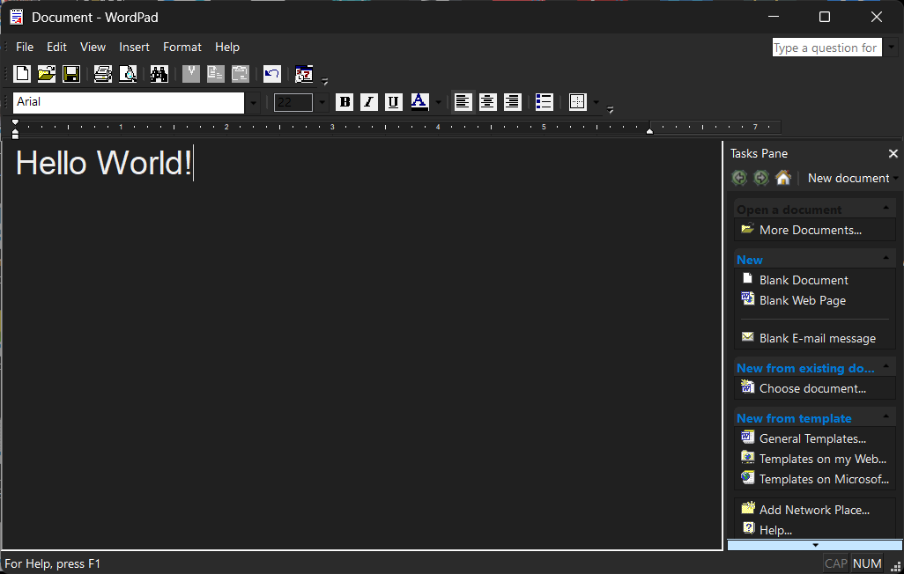

# WordPad Dark Mode Mod

A modification for WordPad (based on Microsoft's MFC samples) to enable native-like Dark Mode support, which dynamically follows Windows system theme settings (`AppsUseLightTheme`).

## Features
- **Dynamic Theming**: Automatically switches between light and dark modes based on Windows personalization settings.
- **MFC Components**: Applies dark themes to toolbars, menus, dialog boxes, and the Tasks Pane.
- **Native Hooks**: Uses `WH_CBT` hooks for process-wide dialog theming.

## Build and Usage

### Build Scripts
- `Build-WordPad.bat`: The primary build script to compile the WordPad solution. Run this from a Visual Studio developer command prompt.
- `*.ps1` scripts: Helper PowerShell scripts were used during development for testing dialog themes, message box capture, and pixel-based verification.

### Requirements
- Visual Studio (with MFC support).
- Original WordPad source code (from [microsoft/VCSamples](https://github.com/microsoft/VCSamples)).

## License
This project is licensed under the MIT License - see the [LICENSE](LICENSE) file for details.
